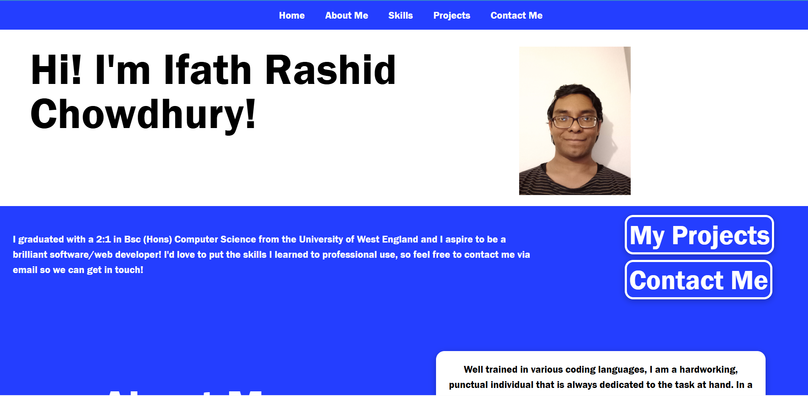
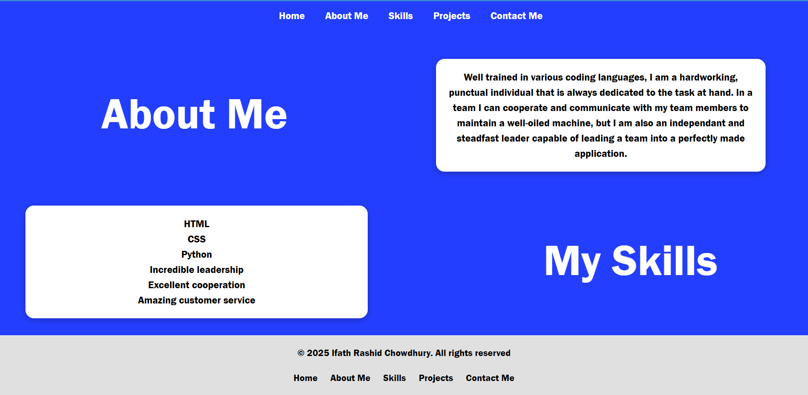
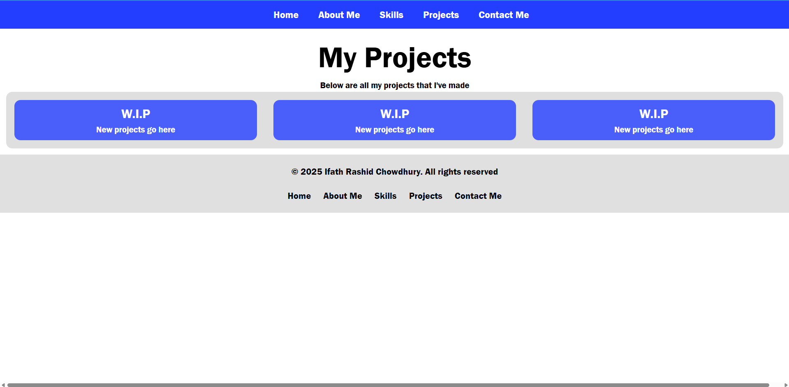
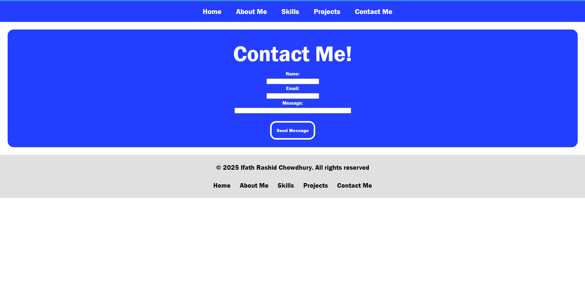

# Personal Portfolio

This is a portfolio website made to advertise my skills and projects I've created to people who may potentially wish to hire me.

Live Demo: https://personal-portfolio-dusky-zeta-53.vercel.app/

---

## Table of Contents

- [Overview](#overview)
- [Features](#features)
- [Tech Stack](#tech-stack)
- [Screenshots](#screenshots)
- [Deployment](#deployment)
- [Future Improvements](#future-improvements)
- [Credits](#credits)

---

## Overview
This project is a portfolio website designed to advertise myself and my skills and personal projects to potential employers. It has some basic information regarding my educational background and my programming skills, as well as a section listing the various projects and websites I've worked on. There is also a contact form for those who wish to contact me.

### Motivation
My motivation to complete this project was my desire to advertise my skills and personal projects to potential employers.

### Objective
The objective of this project was to make a clean portfolio that I can add my projects to.

### Learning Outcomes
- Use HTML and CSS to create a visually appealing portfolio website

---

## Features
- A clean homepage with an "About Me" section and a list of my skills
- A form to get in contact with me

---

## Tech Stack

### Frontend
- HTML
- CSS

---

## Screenshots

---

## Deployment

- Frontend deployed on Vercel

---

# Future Improvements

- Full visual overhaul to make the website stand out
- Add more skills to the "Skills" section
- Add personal projects to the "Projects" section

---

## Credits

Developer: Ifath Chowdhury
GitHub: https://github.com/Ifath-Chowdhury
